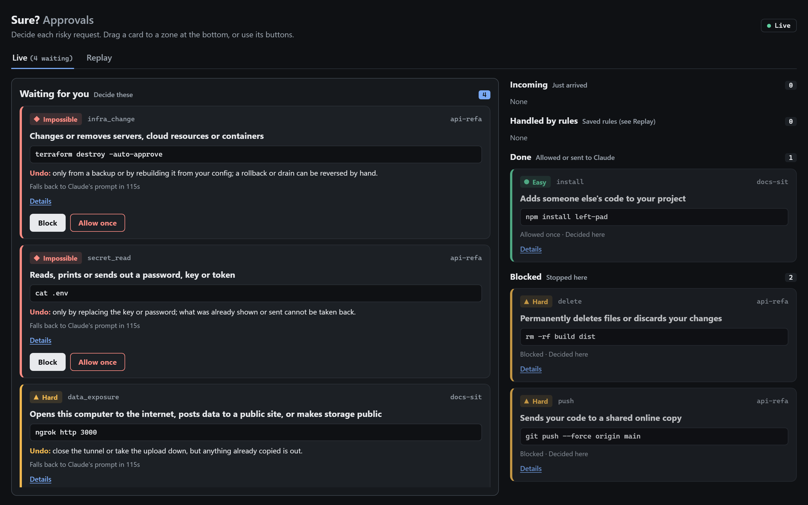
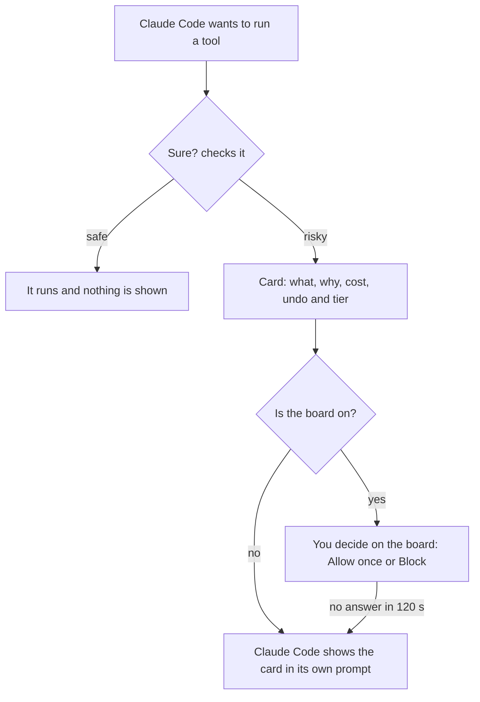
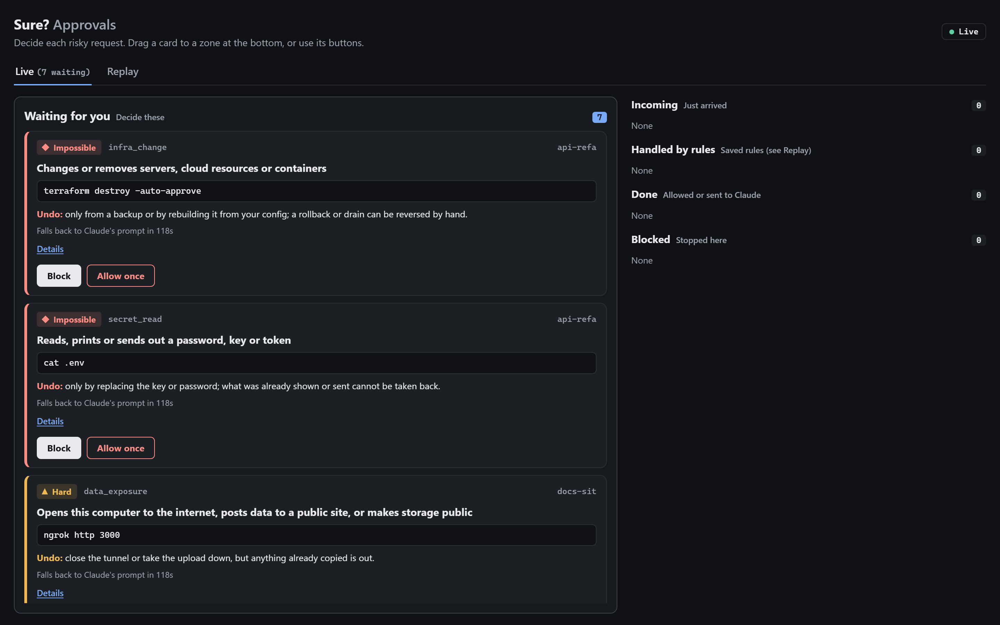
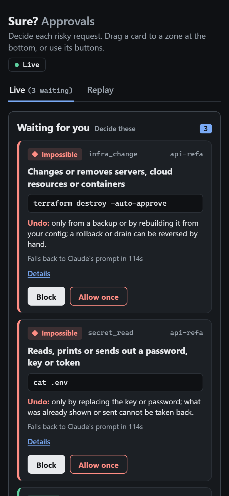

<div align="center">

# Sure?

**A seatbelt for [Claude Code](https://claude.com/claude-code).**<br>
Quiet on safe actions. Before a risky one, a short plain-English card instead of a raw command.

[](LICENSE)




</div>

```
WHAT: Permanently deletes files or discards your changes: rm -rf demo
WHY IT MATTERS: Deleted files skip the recycle bin, and discarded changes are not saved anywhere.
COST: Your work or project files could disappear.
UNDO: Hard: only if the files were saved in git or a backup beforehand.
```

You read a card because it is short and written for people. Each one says **what** will happen, **why it matters**, the **cost**, and whether it can be **undone**. An optional local board lets you decide by dragging the card.

> **Sure? is not a sandbox and not a security boundary.** It helps an owner who is paying attention. If Sure? itself fails, it stays silent and Claude Code's normal prompt applies; it never breaks or blocks the agent. Read [SECURITY.md](SECURITY.md) for what it does and does not protect against, and [RESPONSIBLE_USE.md](RESPONSIBLE_USE.md) before redistributing it.

## Install

```bash
git clone https://github.com/Jrudani21/sure.git
python sure/sure/sure.py install     # adds the hooks to ~/.claude/settings.json
python sure/sure/sure.py uninstall   # removes only Sure?'s own hooks
```

Restart Claude Code afterwards. Built and tested on Windows 11 with Python 3.9+ and the standard library only; other platforms are untested.

<details>
<summary>What <code>install</code> changes</summary>

It keeps every other setting and hook, writes the file atomically, and keeps a rolling backup (`settings.json.sure.bak`) and a one-time original copy (`settings.json.sure.orig`). The PreToolUse hook gets a 130 second timeout so a board wait can finish; it returns in milliseconds when the board is off. A failing command prints one line to stderr and exits 1.

</details>

## Try it

Nothing is run or written. Sure? only shows the card it would show:

```bash
python sure/sure/sure.py check rm -rf build
python sure/sure/sure.py check terraform destroy -auto-approve
python sure/sure/sure.py check --path CLAUDE.md
```

A safe command prints `Sure? would stay quiet: no card for this.`

## How it works



Every card has a **tier** that says how bad a mistake would be:

| Tier | Meaning | What you can do |
|---|---|---|
| **Easy** | Mistakes are simple to reverse | Allow once, Block, or Always allow in that project |
| **Hard** | Reversible only with git or a backup | Allow once or Block |
| **Impossible** | Cannot be taken back | Block, or Allow once with a second confirming click |

## What it flags

25 kinds of risk. Commands are split on `&&`, `||`, `;`, `|`, `&` and newlines, but not inside quotes. `bash -c "..."` and `powershell -Command "..."` payloads are inspected, heredocs that feed a shell or database client are inspected, and leading words such as `sudo`, `time`, `xargs` and `git -C path` are skipped. When several kinds match, the highest tier wins.

- **Destroys things:** deleting files, database changes, live infrastructure, system damage.
- **Leaks secrets or opens your machine:** reading `.env` and keys, public tunnels and uploads, reverse shells.
- **Switches off safeguards:** `--no-verify`, history wiping, weakened tests, edits to Claude's own settings.
- **Runs code you cannot see:** download-and-run, piping into a shell, hidden scripts, commands too long to read.
- **Hands control to agents:** starting other agents, skipping approvals, editing agent instructions, tool servers.
- **Everyday risks:** installs, dependency files, pushes, secrets and login files.

<details>
<summary>The full list, with examples and tiers</summary>

| Kind | Examples | Tier | Card |
|---|---|---|---|
| download_and_run, pipe_to_shell, database | `curl ... \| bash`, `DROP TABLE`, `alembic`, `flyway clean` | impossible | yes |
| reverse_shell | `bash -i >& /dev/tcp/...`, `nc -e`, `socat EXEC:`, Python/Perl/PHP/Ruby socket shells | impossible | yes |
| infra_change | `terraform apply/destroy`, `kubectl delete/drain`, `helm uninstall/rollback`, `aws ... delete/terminate`, `gcloud/az ... delete`, `docker system prune`, `docker volume rm`, `docker compose down -v` | impossible | yes |
| secret_read | `cat .env`, `cat ~/.ssh/id_rsa`, `printenv`, `echo $API_TOKEN`, `gh auth token`, `aws secretsmanager get-secret-value`, `kubectl get secret -o yaml`, `scp .env host:` | impossible | yes |
| data_exposure | `ngrok http`, `ssh -R`, uploads to `transfer.sh`/`0x0.st`/`gh gist create`, `aws s3 ... --acl public-read`, `gsutil iam ch allUsers:...` | hard | yes |
| safeguard_bypass | `git commit --no-verify`, `core.hooksPath /dev/null`, `gh pr merge --admin`, `history -c`, `Set-ExecutionPolicy Bypass`, `ssh -o StrictHostKeyChecking=no` | hard | yes |
| agent_autonomy | `claude -p`, `codex exec`, `--dangerously-skip-permissions`, `--yolo`, `claude mcp add`, `AIDER_YES_ALWAYS=true` | hard | yes |
| agent_config_edit | `CLAUDE.md`, `AGENTS.md`, `.cursorrules`, `.mcp.json`, skills, commands and agent memory folders | hard | yes |
| system_damage | `chmod -R 777`, `mkfs`, `dd of=/dev/...` | hard | yes |
| delete, push, script_launcher | `rm -rf`, `Remove-Item`, `git push --force`, `npm run`, `make` | hard | yes |
| unreadable_command | a command over 4000 characters with nothing else matched | hard | yes |
| test_tampering | `jest -u`, `pytest --snapshot-update`, `--cov-fail-under=0`, `[skip ci]`, `sed -i` adding `.skip(`, `git rm tests/...` | hard | yes |
| install | `npm install`, `pip install`, `cargo add` | easy | yes |
| config | `package.json`, `requirements.txt`, `Dockerfile` | easy | yes |
| secrets_and_auth | `.env`, auth, middleware, secret, credential, migration and schema files | hard | yes |
| settings_or_mode, protected_path_write | `.claude/settings.json`, `sure.json`, `.sure/`, anything under `.git/` or `.claude/` | hard | yes |
| WebFetch, WebSearch, Task, Agent | | easy | logged only |
| MCP tools (`mcp__*`) | | hard when the name has a mutating word (delete, send, reply, forward, share, connect, update, javascript, ...) | otherwise logged only |

"Logged only" means Sure? adds no card, so Claude Code's own permission flow decides. The desktop app's own `mcp__ccd_*` tools are logged only except delete, archive, stop and merge style names.

The rules are plain data in [`directory/permissions.json`](directory/permissions.json), checked against a labelled corpus of 640+ commands (risky ones and safe look-alikes) in [`tests/data/classifier_corpus.json`](tests/data/classifier_corpus.json).

</details>

### Block file reads too

Read-only tools (Read, Grep, Glob) are not hooked, so Sure? cannot see Claude opening `.env` or a key file with the Read tool; it only sees shell commands such as `cat .env`. Claude Code's own `permissions.deny` rules cover the Read tool. Neither covers the other, so use both.

<details>
<summary>Deny rules to add</summary>

Put this in `~/.claude/settings.json` to apply it in every project:

```json
{
  "permissions": {
    "deny": [
      "Read(.env)",
      "Read(.env.local)",
      "Read(.env.production)",
      "Read(~/.ssh/**)",
      "Read(~/.aws/**)",
      "Read(~/.kube/config)"
    ]
  }
}
```

Notes, from [Claude Code's permissions docs](https://code.claude.com/docs/en/permissions):

- A bare filename such as `Read(.env)` matches at any depth. `~/` is your home folder. A single leading `/` is **not** the filesystem root; it anchors at the settings file, so use `//` for an absolute path.
- On Windows, write forward slashes. Paths are normalized before matching, so `C:\Users\you` is `/c/Users/you`, and `//c/**/.env` matches `.env` anywhere on the C: drive.
- Deny always wins over allow. `Read(.env.*)` would also block `.env.example`, so the list above names the real files instead.
- The docs say Read rules are applied on a best-effort basis to Grep, Glob and similar built-in tools, and to recognized shell file commands such as `cat`. They do not cover a script that opens files itself. Do not treat either layer as a guarantee.
- Check what is active with `/permissions` inside Claude Code.

</details>

## The board

Run `board`, open the printed URL in a browser, and turn it on in a project with `board on`. A risky request becomes a card and the hook waits up to 120 seconds for you.

<table>
<tr>
<td width="66%"></td>
<td></td>
</tr>
</table>

- Drag a card to **Allow once**, **Block**, **Ask Claude** or **Always allow** (easy kinds only; it saves `auto_allow` in that project). Every card also has real buttons for keyboard and touch use.
- Impossible-tier cards offer only **Block** and **Allow once**, and Allow once needs a second click.
- Each card shows the plain title, the tier, how to undo it and a countdown. **Details** opens the full command (up to 2000 characters), why it matters and the cost.
- A flow map shows sessions, kinds and who decided. A Trusted kinds strip lists your Always allow choices with a remove button. A Replay tab shows past decisions for a project and a day range.
- If the board is not running, no browser tab is visible, the runtime file is stale, or nobody answers, Claude Code's normal prompt takes over.

"Allow once" returns a real `allow` to Claude Code. That skips Claude's own prompt, but your deny rules still win (checked by a test). Auto and bypass permission modes and `ask` rules were not tested.

## How it compares

Several good open-source tools guard coding agents. They solve overlapping problems with different trade-offs. This table is drawn from each project's own README (October 2026), so check the projects for current details.

| | **Sure?** | [AgentTrail Guard](https://github.com/agenttrailhq/guard) | [cc-safety-net](https://github.com/kenryu42/cc-safety-net) | [Cupcake](https://github.com/eqtylab/cupcake) |
|---|---|---|---|---|
| **Approach** | Pattern rules kept as plain data | Pattern rules in 11 packs (74 rules) | Parses what a command does, plus rulebooks | Policy as code (OPA/Rego compiled to Wasm) |
| **Agents** | Claude Code | Claude Code, Cursor, Codex CLI | 17 coding CLIs | Claude Code, Cursor, Factory AI, OpenCode |
| **What you see** | Four plain-English lines (what, why it matters, cost, undo) and a tier | Rule id, title and reason | A block message that explains why | A policy feedback message |
| **Deciding** | Local board: drag a card to Allow once, Block, Ask Claude or Always allow; flow map and replay | The agent's own prompt; rules block, ask or warn | The agent's own prompt; a GUI to pick presets and toggle rules | Allow, modify, block, warn or require review |
| **Tuning** | `sure.json` options per project | Allow one command shape, change a rule's action, disable a pack, add rules with test fixtures | Standard, Strict and Paranoid presets; custom rulebooks | Write your own policies |
| **Looking back** | Replay tab and a ledger per project | `scan` replays past transcripts into an HTML report | Audit log, `doctor` and `explain` | Structured logs and traces |
| **Needs** | Python 3.9+, no packages | Node.js 20+ | Node.js 18+ | A Rust CLI |

**Choose Sure? when** you want every risky action explained in plain words with an undo answer, a local board to decide on, a tool built and tested on Windows, and nothing to install beyond Python.

**Choose another when** you need more rules today (Guard), real shell parsing or many different agents (cc-safety-net), policy as code and enterprise controls (Cupcake), a real parser for many shells ([vouch](https://github.com/polston/vouch)), auto-approval of known-safe commands ([Dippy](https://github.com/sebb3/Dippy)), or the most packs and agents ([dcg](https://github.com/Dicklesworthstone/destructive_command_guard)).

**Where Sure? is behind:** the public repo supports Claude Code only, detection is pattern matching and not a shell parser, and it does not yet have custom rules with a test runner. Common shell disguises (`r''m`, `$IFS`, `$(echo rm)`, variables used as the command) are unwrapped before the rules run, but nothing beyond that is simulated. That is on the list, and the gaps above are listed on purpose so you can judge it for what it is.

## Commands

```bash
python sure/sure/sure.py check <command>   # show the card for a command without running it (--path <file> for a file)
python sure/sure/sure.py status            # is the hook installed and healthy, this project's options, recent decisions
python sure/sure/sure.py scan [--days 30] [--html report.html]   # replay your Claude Code history through today's rules (read-only)
python sure/sure/sure.py stats          # asked / ran / approval rate per kind (run in a project)
python sure/sure/sure.py report 7       # last 7 days in plain words, with a nudge if you approve almost everything
python sure/sure/sure.py undo 1         # restore save point 1 (needs save points; it does not delete new files)
python sure/sure/sure.py board          # start the local board, prints http://127.0.0.1:<port>/#<page key>
python sure/sure/sure.py board on|off   # enable or disable the board for the current project
```

## Project options

`sure.json` in the project folder:

```json
{
  "save_points": { "enabled": true },
  "auto_allow": ["install"],
  "ask_on": ["web_search"],
  "board": { "enabled": true }
}
```

- `save_points`: a git snapshot before risky actions (tracked changes only).
- `auto_allow`: no card for these kinds. Only easy kinds are honoured; hard and impossible kinds always ask.
- `ask_on`: force a card for a kind that is normally quiet. It wins over `auto_allow`.
- `board`: when enabled, risky requests wait on the board.

Sure? reads `sure.json` and writes `.sure/` in Claude's current working folder, which can be a subfolder of your repo.

<details>
<summary>Files Sure? writes</summary>

- `~/.sure/board.json`: board port, hook key and process id while a board runs (no page key).
- `<project>/.sure/ledger.md`: readable decision log with the first 80 characters of risky commands. Secrets and URL passwords are masked.
- `<project>/.sure/events.jsonl`: kind, tier, session, decision and a short title. `.sure/.gitignore` contains `*`.
- `<project>/sure.json`: your options, and `auto_allow` when you use Always allow.
- `settings.json.sure.bak` and `settings.json.sure.orig` next to the settings file the installer changed.

The hook makes a short HTTP call to 127.0.0.1 only when a project has the board enabled. Sure? makes no other network calls and calls no model.

</details>

## Known limits

- Detection is pattern matching, not a shell parser. Unusual quoting, wrapper forms, `$(...)` inside `echo`, some PowerShell constructs (`Start-Process -Verb RunAs`, `Format-Volume`, ...), and tools such as `rsync --delete`, `truncate`, other forms of docker, kubectl and cloud commands (for example `docker rm -f` or `kubectl scale --replicas=0`), and commands split across lines with `\` can get past it.
- It cannot see what a script does once launched, and it does not inspect MCP tool input.
- Anything running as you, including the agent, can tamper with Sure? (see [SECURITY.md](SECURITY.md)).
- A visible but unattended board tab makes the hook wait up to 120 seconds.

## Develop

```bash
python -m pytest -q
ruff check sure tests scripts
python scripts/live_board_smoke.py    # needs SURE_SMOKE_ROOT=<a folder>, runs two real `claude -p` sessions
```

[MIT licensed](LICENSE). Please read [RESPONSIBLE_USE.md](RESPONSIBLE_USE.md) before redistributing or building on it.

Want the story behind the rules, including the bugs the test gates caught? Read the [case study](https://jrudani21.github.io/case-study-sure.html).
